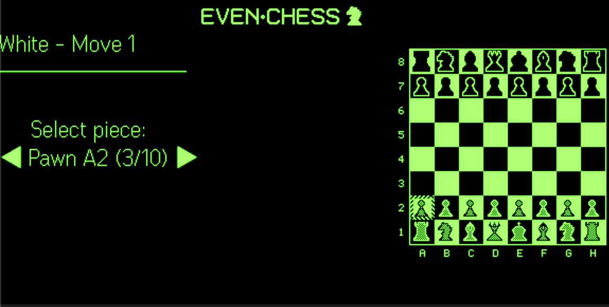
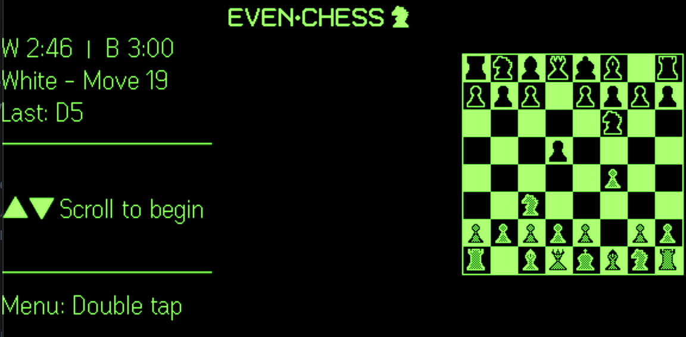
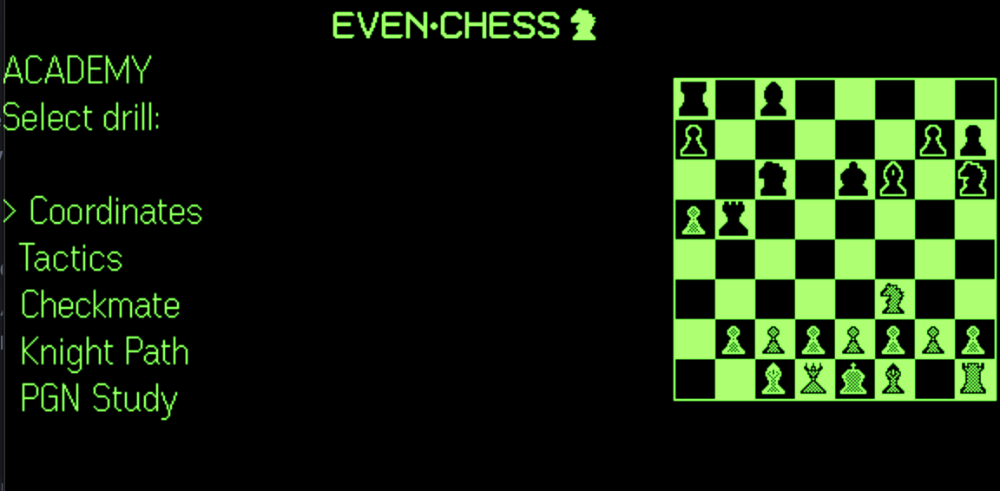

# Chess

Chess for **Even Realities G2** smart glasses: play vs Stockfish, race the clock in Bullet Blitz, or train in the Academy. Use the ring controller (R1) or touchpad: scroll to move, tap to select. You can also speak your moves (optional, fully on-device).

Licensed under the MIT License (see [LICENSE](LICENSE)); bundled third-party components keep their own licenses (see [Licenses / third-party](#licenses--third-party)).

## Screenshots

| Play: piece selection | Menu | Academy: drill selection |
|------------------------|------|-------------|
|  |  |  |

| Bullet Blitz: timed game | Mode select |
|---------------------------|----------------------------|
|  |  |

## Quick links

- **In-app help:** open the app on your phone for the full instructions (getting started, modes, controls, Academy). Same content as [index.html](index.html).
- **Contributing:** [CONTRIBUTING.md](CONTRIBUTING.md). **Code map and conventions** (for contributors and coding agents): [AGENTS.md](AGENTS.md).
- **Changes:** [CHANGELOG.md](CHANGELOG.md).

## Features

- **Play vs AI:** play White, Black, or Random against Stockfish; Easy, Casual, Serious, or Custom (levels 0–9) difficulty. Games auto-save.
- **Bullet Blitz:** timed games: 1+0, 1+5, 3+0, 3+5, 5+0, 5+5. The clock pauses while a system overlay is open or the app is in the background.
- **Academy:** Coordinates, Tactics, Checkmate, Knight Path, PGN Study (famous games, move by move).
- **Voice moves (optional):** tap in idle and say a move ("Knight to C3", "E takes D5", "castle king side"). The recognized move is shown for confirmation before it is played. Recognition runs fully on-device; see [Voice input](#voice-input).
- **Menu:** Play As, Mode, View Log, Difficulty, Display Options (Alignment, Size, Board Markers A–H · 1–8, Position: your pieces at the bottom or top), Reset, Exit. Double-tap from idle to open it. Difficulty, display options, and Play As are saved.

## Usage on the glasses

- **Scroll:** move the selection on the board or in menus. From idle, scrolling starts a manual move.
- **Tap:** select a square, confirm a move, or choose a menu item. From idle, a tap starts voice input (or a manual move if voice is unavailable).
- **Double-tap (from idle):** open the menu.
- **Double-tap (during selection):** back up one step (destination → piece → row → idle).

### Voice input

1. In idle, **tap**. The HUD shows "Listening… speak your move". Listening stops after a short silence (or about 7 seconds). Tap again to cancel.
2. The HUD shows **"Heard: …"** (for example "Heard: Knight C3").
3. **Tap** to play it, **double-tap** to cancel, or **scroll** to discard it and pick the move manually.

Files can be letters ("c3") or NATO words ("charlie three"). Captures, castling, promotion ("E8 queen"), and naming the source square ("knight B1 to C3") are supported. If a move is ambiguous or not legal, the HUD says so and nothing is played.

Voice needs the speech model (see [Setup](#setup)). Without it, or if the microphone is unavailable, a tap in idle starts a manual move as before. The app uses the `g2-microphone` permission; audio is transcribed on-device by [vosk-browser](https://github.com/ccoreilly/vosk-browser) and is not sent anywhere. That is the app's only permission.

## Prerequisites

- **Even Realities:** G2 glasses and the [Even App](https://www.evenrealities.com/) **version 2.2.10 or newer** (required by SDK 0.0.16).
- **Node.js:** v20.19.0 or newer.
- **For the voice model only:** `unzip` and `tar` on your `PATH` (used by `npm run fetch:voice-model`).

## Setup

1. **Clone and install**
   ```bash
   git clone https://github.com/dmyster145/EvenChess.git
   cd EvenChess
   npm install
   ```
   `npm install` runs a postinstall step that copies the Stockfish worker and WASM from `node_modules/stockfish.js` into `public/stockfish/` (not committed).

2. **(Optional) Fetch the voice model**
   ```bash
   npm run fetch:voice-model
   ```
   Downloads the Vosk small English model (~40 MB), checks its SHA-256, and writes `public/vosk/model.tar.gz` (not committed). Skip this if you don't need voice; the app falls back to manual moves.

3. **Run locally**
   ```bash
   npm run dev
   ```
   The dev server listens on port 5173 on **all network interfaces** (`host: '0.0.0.0'` in [vite.config.ts](vite.config.ts)) so your phone and glasses can reach it over the LAN. Anyone on the same network can reach it too, so use it on trusted networks only.

4. **Open in the Even App**
   - **Option A:** run `npm run qr` and scan the QR code with the Even App.
   - **Option B:** open `http://<your-computer-ip>:5173` in the Even App.

5. **Try it**
   - On your **phone:** the page shows the help (getting started, modes, controls).
   - On your **glasses:** scroll to start a move, tap to speak a move, double-tap from idle to open the menu.

To try it without glasses, use the simulator; see [AGENTS.md](AGENTS.md#simulator).

## Scripts

| Command | Description |
|---------|-------------|
| `npm run dev` | Start the dev server (LAN-visible, port 5173) |
| `npm run build` | Typecheck (`tsc -b`) and build to `dist/` |
| `npm run preview` | Preview the production build |
| `npm test` | Run tests once (Vitest) |
| `npm run test:watch` | Run tests in watch mode |
| `npm run lint` | Lint `src/` and `tests/` |
| `npm run fetch:voice-model` | Download and repackage the Vosk model into `public/vosk/` (needs `unzip`, `tar`) |
| `npm run qr` | Show a QR code for the dev server, to scan with the Even App |
| `npm run pack` | Package `dist/` as `chess.ehpk` (Even Hub CLI) |

## Build and package

```bash
npm run build
npm run pack
```

`dist/` is a static site. `npm run pack` runs `evenhub pack app.json dist -o chess.ehpk`; the result, `chess.ehpk`, is what you submit to Even Hub. Run `npm run fetch:voice-model` before building if the package should include voice.

## Tech stack

- **Runtime:** TypeScript, Vite
- **Chess:** [chess.js](https://github.com/jhlywa/chess.js) for rules, FEN, and PGN. [Stockfish](https://stockfishchess.org/) (stockfish.js WASM build) in a Web Worker. If the engine can't load, the app plays random moves.
- **Voice:** [vosk-browser](https://github.com/ccoreilly/vosk-browser) with a grammar limited to chess moves, fed by the SDK's microphone PCM stream.
- **Glasses:** [Even Hub SDK](https://www.npmjs.com/package/@evenrealities/even_hub_sdk) for containers, image updates, and input events
- **Tests:** Vitest

## Project structure

```
EvenChess/
├── index.html            # Phone help page; mounts the app
├── app.json              # Even Hub manifest (version, min app/SDK, permissions)
├── scripts/              # copy-stockfish (postinstall), fetch-vosk-model
├── public/               # Static files; stockfish/ and vosk/ are generated, not committed
├── src/
│   ├── main.ts           # Boot
│   ├── app.ts            # Wires store, bridge, renderer, engine, voice, lifecycle
│   ├── app/              # Side effects: render flush, lifecycle, autosave, bullet timer, startup
│   ├── state/            # Contracts, pure reducer, selectors, store, menu tables, phase groups
│   ├── input/            # SDK event → Action mapping, duplicate-event filters
│   ├── evenhub/          # SDK bridge: serialized calls, page setup, storage, exit dialog
│   ├── render/           # Page layout (composer), board image, captured-pieces strip, PNG/BMP
│   ├── chess/            # ChessService (chess.js wrapper), square helpers
│   ├── engine/           # Stockfish worker bridge, turn loop, difficulty profiles
│   ├── voice/            # Push-to-talk: controller, recognizer, grammar, parse, resolve, PCM
│   ├── academy/          # Drills, tactics/mate puzzles, knight paths, famous games
│   ├── bullet/           # Clock formatting (the clock itself runs in the reducer)
│   ├── storage/          # Saved game and settings, background-state snapshot hooks
│   ├── utils/            # WebView keep-alive
│   ├── debug/            # In-app debug log, board snapshot for the phone page
│   └── perf/             # Optional perf logging
└── tests/                # Vitest suite mirroring src/ (+ tests/helpers/)
```

## Licenses / third-party

The MIT license covers this project's own code. Bundled components:

| Component | License | Notes |
|-----------|---------|-------|
| [Stockfish](https://stockfishchess.org/) | GPL-3.0 | WASM build from stockfish.js v10.0.2 ([source](https://github.com/niklasf/stockfish.js/tree/e105072e84cf8ee5dd5219e2c5be29c3b8bf8a5a), the "Bump 10.0.2" commit). Copied from `node_modules` into `public/stockfish/` on `npm install`, together with the license text (`Copying.txt`) and a source link (`SOURCE.txt`). Any build that includes Stockfish must meet GPL-3.0 for that component. |
| [chess.js](https://github.com/jhlywa/chess.js) | BSD-2-Clause | © Jeff Hlywa |
| [vosk-browser](https://github.com/ccoreilly/vosk-browser) | Apache-2.0 | Speech recognition |
| [Vosk small English model](https://alphacephei.com/vosk/models) (`vosk-model-small-en-us-0.15`) | Apache-2.0 | Downloaded by `npm run fetch:voice-model`; not committed |
| [upng-js](https://github.com/photopea/UPNG.js) | MIT | PNG encoding |
| [DM Sans](https://fonts.google.com/specimen/DM+Sans) | SIL OFL 1.1 | Help-page font, self-hosted via `@fontsource/dm-sans` |
